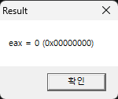

# DAY6 ASM 작성 및 실행과 정리 그리고 함수  
### 시작하기 전에...  
선생님께 .exe실행 파일을 전송받았습니다.  
이 실행피일 이름은 **loop.exe**이고 레치스터(변수)EAX의 갋을 10진수와 16진수로 보여주는 윈도우 api알림창을 띄웁니다.



어셈블리 코드 내부에는 자율적으로 코드를 짤수 있는 (nop)영역이 있습니다.


이 nop영역에서 코드를 짜고 그 EAX의 갋을 바꾸면 출력은 바뀐 EAX의 갋을 보여줍니다.  
## ASM 작성 연습 주제 선정  
주제는 선생님이 제시 하였고 어셈블리를 사용하여 1부터 100까지 모든 숫자를 더하는 코드를 작성해야 합니다.  
규칙 에시: 1 + 2 + 3 + 4 + 5 + 6... + 100 = ?  
먼저 정답을 이야기 한다면, 1부터 100까지 모든 수를 더한 갋은 5050이 되야 합니다.  
## ASM 로직 구상  
ASM을 먼저 마로 작성을 하려면 시간이 오래 걸리고 난이도가 너무 높기 떄문에 먼저 C를 사용하여 초기 설계도를 만들어 보았습니다.  
다음에 나오는 코드는 그 설계도의 모습과 설명입니다. 
```c
#include <stdio.h>              //c 선언

int main(){                     //main함수 선언(본문 만들기)
    int a=0;                    //a라는 변수 선언

    for (int i=0; i<=100; i++){ //i라는 변수와(0) 100까지 i에다 1식 더하면서 17번 줄까지 있는 내용 반복
        a=a+i;                  //a에다i를 더하기(누적)
    }                           //반복문 경계선
    
    printf("%d",a);             //a를 출력(ASM에서 이 코드는 구연 되어 있습니다)
    return 0;                   //반환(지금은 필요 없음)
}
```  
| *[원문 :DAY5 main.c](../DAY5/files/main.c)*  
## ASM실전 작성  
C의 로직을 토대로 ASM을 작성하였고 그 결과는 이렇습니다.  
```asm
xor ebx, ebx   
cmp ebx, 100   
ja (line x)   
add eax,ebx    
jmp (line y)  
```  
| *[원문 :DAY5 main.c](../DAY5/files/main.c)*   
그런데 실제 작성된 모습이 조금 다릅니다.  

  

이는 코드가 쓴 갋과 출력이 요구하는 갋이 달라 살작 변경을 해 주었습니다(기본 원리는 100%같음)  
또 작성은 전부 16진수를 직접 입력 하여야 합니다.      
| *[결과ASM바이너리 코드(전체) :DAY5 loop.asm](../DAY6/files/asm/loop.asm)*  
~~사실 다음부더 ASM코드는 git 에 전부 다 안올릴게요. 너무 랙걸ㄹ~~  
## 스텍과 함수  
x32dbg에는 4가지의 큰 창이 있습니다. 각각,  
- [바이너리](./files/image/image%20copy%203.png)
- [레치스터](./files/image/image%20copy%204.png)
- [메모리](./files/image/image%20copy%205.png)
- [스텍](./files/image/image%20copy%206.png)  

그래서 이 창 중에 바이너리와 스텍이 이 주제에서 정말 중요합니다.  
우선 스텍은 후입선출의 특성을 가지고 있다.(나중에 들어간것이 먼저 나온다)  
마치 프링글스 통 이라고 생각하면 쉽습니다.  
정보 여려개를 순차적으로 넣는다면 그 정보들은 1차원적으로 쌓이고 멘 아렜것을 꺼내려면 위에 있는 모든 정보를 빼 내야 합니다.  
또한 스텍은 2가지의 칸이 존제하는데 `00000000|00000000` 왼쪽은 오른쪽을 위한 레이블이고(**갈수록 4 씩 거꾸로 감**) 오른쪽은 스텍에 들어가는 본문(16진수)입니다.  
본론으로 돌아가서, 이번에도 함수 공부를 위해 C코드로 설계도를 만듭니다.  
```c
#include <stdio.h>
int add(int a, int b) {         //add라는 함수 생성
    return a + b;               //이 함수는 그저 a와b를 더합니다
}

int main() {                    //main이라는 함수(add함수를 호출하고 결과를 보여주는 역할)선언
    int result = add(3, 4);     //a와b를 받는 모습
    printf("%d", result);
    return 0;
}
```  
| *[원문 :DAY6 main.c](../DAY6/files/main.c)*   
또한 ASM으로 변환해본 모습입니다.  
```asm
push 4                | 스텍에 4를 밀어넣습니다.
push 3                | 스텍에 3을 밀어넣습니다.
call add[line x]      | add를 수행하기 위한 임의의 줄로 점프 합니다.
add esp, 8            | 스텍에 2바이트를 버립니다.
```  
| *[원문 :DAY6 asm.c](../DAY6/files/asm.c)*  

다시 설명을 해 보자면,  

0. 기본 상황  
```
0060ff74|00000000
0060ff78|00000004
0060ff7c|xxxxxxxx<--esp  
```
1. 스텍에 4를 집어넣고  
```
0060ff74|00000000
0060ff78|00000004<--esp
0060ff7c|xxxxxxxx
```  
2. 스텍에 3을 집어넣고  
```
0060ff74|00000003<--esp
0060ff78|00000004
0060ff7c|xxxxxxxx
```  
3. 함수 호출  
임의의 영역에서 그 2개의 pop 합니다.
또 그곳에서 ADD문을 실행합니다.  

4. 함수가 종료되니 현제 cpu가 사용하는 ESP에 8을 **더해서** 마무리를 합니다.  
```
0060ff74|00000003
0060ff78|00000004
0060ff7c|xxxxxxxx<--esp  
```

## 명령어와 변수 정리  
jmp = 특정 줄로 점프  
cmp = 뺴기 후 ZF,CF를 변경(인풋이 뭐였냐에 따라 다름)  
j시리즈 = cmp와 거의 같이 사용되며 XF,CF의 갋에 조건을 메게고 그 조건에 따라 점프 혹은 패스를 함.  
add = 두 수자를 더하기.  
xor = 두 수자를 XOR.  
push = 스텍에 숫자 넣기
pop = 스텍에 숫자 뺴고 쓰기  
call = 호출  
EIP = 현제 바이너리 실행 위치  
ESP = 현제 스텍 위치  
EBX,EAX = 변수  
~~지금까지는 변수로 알고 있지만 또 어떤특성이 있을지 모름~~